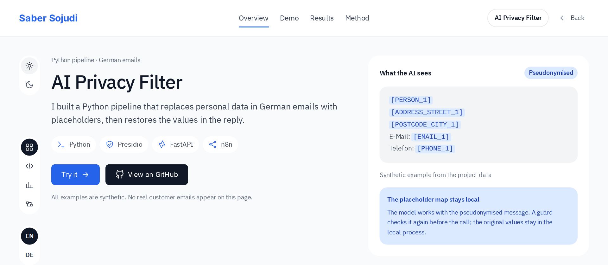
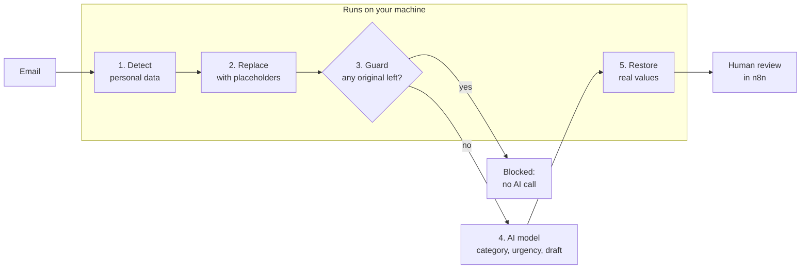
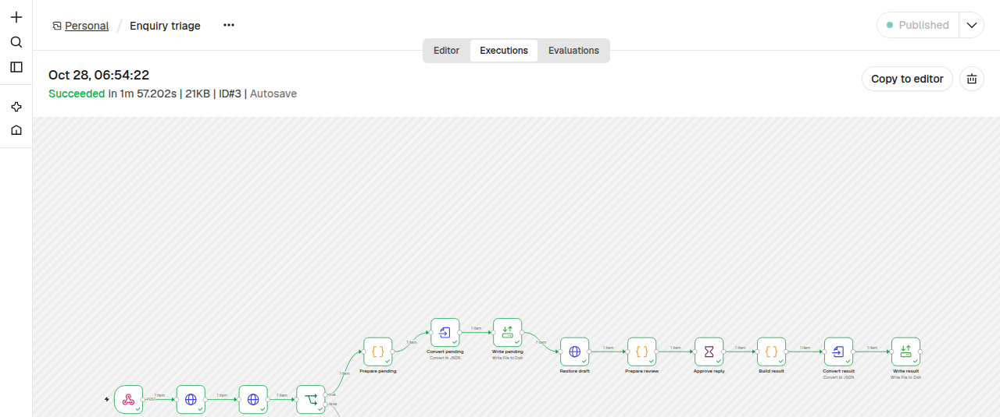
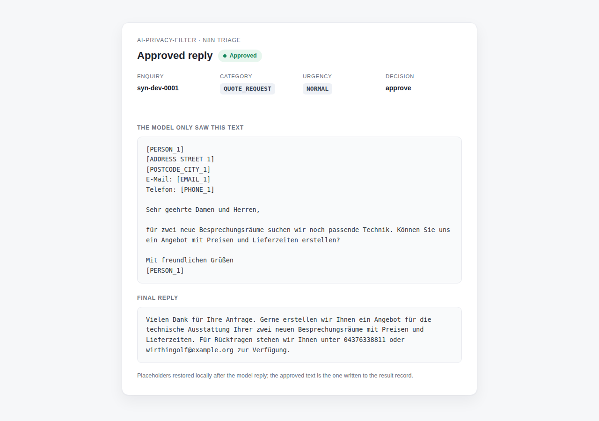

# AI Privacy Filter

[](https://github.com/sabers13/ai-privacy-filter/actions/workflows/ci.yml)


**Let an AI model sort and answer German customer emails without ever seeing
the customer's name, address, phone number or bank details.**

[Project page with live demo](https://sabersojudi.com/ai-privacy-filter/) ·
[Results summary](results/SUMMARY.md) ·
[Evaluation method](METHOD.md)



---

## The idea in one example

A customer writes:

```text
Guten Tag, hier ist Anna Schmidt, Tel. 0171 2345678, IBAN DE89 3704 0044 0532 0130 00.
Bitte um ein Angebot.
```

The AI model only ever receives:

```text
Guten Tag, hier ist [PERSON_1], Tel. [PHONE_1], IBAN [IBAN_1].
Bitte um ein Angebot.
```

The filter pseudonymises the email, and the model returns a category, an
urgency and a draft reply written with the placeholders. The real values are put back on your machine, and a person
approves, edits or rejects the reply before anything goes out.

This is **pseudonymisation, not anonymisation**: the original values still exist
in a local, in-memory map so they can be restored. The project is a technical
filter, **not legal advice** and not a compliance certification.

## How it works



1. **Detect.** Microsoft Presidio with the German spaCy model `de_core_news_lg`,
   plus German rules for phone numbers, IBANs (with checksum), postcode + city,
   street + house number, VAT IDs, dates of birth, names and company names.
2. **Replace.** Each value becomes a typed, numbered placeholder such as
   `[PERSON_1]` or `[IBAN_1]`. The same value always gets the same placeholder
   within one email.
3. **Guard.** Before any network call, the outgoing text is checked again for
   every value that was found (digits-only too, for phones and IBANs). If one is
   still there, the AI call is blocked.
4. **Ask the model.** Only the pseudonymised text is sent. The model answers
   with JSON: `category`, `urgency`, `reply_draft`.
5. **Restore.** Placeholders in the draft are replaced with the real values for
   the reviewer. The mapping lives in process memory only and is never logged
   or written to disk.

Steps 1, 2, 3 and 5 make no network calls: the filtering runs entirely on your
machine, and `make test-local` runs it with all sockets disabled to prove it. The AI request in step 4 is the only thing that
leaves the machine.

## Results

Measured once on the held-out test splits, with 95% Wilson confidence intervals. No
setting was tuned on the test split. Every number links to the file it comes from.

| What was measured | Result |
|---|---|
| Personal details caught (160 synthetic German emails, 1,074 labelled values) | **[99.5%](results/SUMMARY.md)** (1,069 / 1,074, CI 98.9–99.8) |
| Emails where at least one value still reached the outgoing text | **[1.9%](results/leak_rate.json)** (3 / 160, CI 0.6–5.4) |
| Text masked that was not personal data | **[0%](results/detection_synthetic.json)** (0 of 19,824 replaced characters) |
| Emails restored byte-for-byte after pseudonymisation | **[160 / 160](results/restore.json)** |
| Names and organisations found in real German text (GermEval 2014 test: Wikipedia and news) | **[78.4%](results/detection_germeval.json)** (2,186 / 2,789, CI 76.8–79.9) |

The custom German configuration is what makes the difference. On the same 160
emails, plain regex rules leak personal data in **[160 / 160](results/detection_synthetic.json)** emails and
Presidio's default setup in **[145 / 160](results/detection_synthetic.json)**; the full configuration in **[3 / 160](results/leak_rate.json)**.
The 5 values it missed were 2 street addresses and 3 postcode + city pairs. The
guard cannot block a value the detector never found, which is why those 3 emails
count as leaks.

The synthetic number flatters the filter: real text is harder, which is why the
GermEval result is reported next to it.

### AI backends: sorting 40 fixed emails

| Backend | Category correct | Urgency correct | Both correct | Median time | Values leaked |
|---|---:|---:|---:|---:|---:|
| Claude (via `claude` CLI) | 87.5% | 82.5% | 70.0% | 5.2 s | 0 |
| DeepSeek V4.1 Flash (OpenAI-compatible API) | 80.0% | 87.5% | 67.5% | 4.8 s | 0 |
| GPT (via `codex` CLI) | 80.0% | 82.5% | 62.5% | 6.7 s | 0 |
| Qwen2.5 1.5B (local, Ollama, CPU only) | 57.5% | 57.5% | 37.5% | 4.3 s | 0 |

Full table with intervals and per-category findings:
[`results/runs/20261027T131500Z-triage-a1ad8ff/report.md`](results/runs/20261027T131500Z-triage-a1ad8ff/report.md).
The small local model is clearly weaker and invented placeholders in 13 of 40
drafts. It shows the pipeline can run without a cloud AI, not that it should.

## Quick start

Requires Python 3.12+ and [uv](https://docs.astral.sh/uv/).

```sh
git clone https://github.com/sabers13/ai-privacy-filter.git
cd ai-privacy-filter
make setup        # dependencies + the pinned German spaCy model (~540 MB)
make test         # full test suite, no AI calls
```

### Command line

```sh
# Pseudonymise a text (no AI involved)
echo "Guten Tag, hier ist Anna Schmidt, Tel. 0171 2345678." | uv run aipf redact

# Full pipeline with the built-in offline test backend
echo "Guten Tag, hier ist Anna Schmidt, Tel. 0171 2345678." | uv run aipf process --backend fake --restore

# Same with a real model, e.g. your Claude subscription
uv run aipf process --backend claude-cli --restore "..."
```

### HTTP service

```sh
uv run aipf serve          # http://127.0.0.1:8765, interactive docs at /docs
```

| Endpoint | Purpose |
|---|---|
| `GET /health` | liveness check |
| `POST /redact` | pseudonymise `{"text": ...}`, returns the text and a short-lived ticket |
| `POST /restore` | put the real values back into a draft using that ticket |
| `POST /process` | detect → guard → AI → restore in one call (`{"text": ..., "backend": ...}`) |

### Human review in n8n

```sh
make demo         # starts the service + n8n locally and seeds 3 synthetic emails
make demo-down    # stops everything and deletes the demo data
```

`make demo` prints a review link for each email. The form shows the
pseudonymised email, the suggested category and urgency, and the restored
draft; the reviewer chooses approve, edit or reject.

| Workflow run | Reviewer corrects the draft |
|---|---|
|  |  |

`make e2e` runs the same flow automatically: five synthetic emails, approve /
edit / reject decisions, and a check that no original value appears in what
was sent to the model. See [`docs/n8n.md`](docs/n8n.md). This is a local
demonstration, not a production deployment: no authentication on the webhook,
no retries, no mail inbox connection.

## Choosing an AI backend

All backends share one interface and receive only pseudonymised text.

| Backend | Uses | Set up with |
|---|---|---|
| `claude-cli` | your Claude subscription | the installed `claude` CLI, logged in |
| `codex-cli` | your ChatGPT subscription | the installed `codex` CLI, logged in |
| `byok` | any OpenAI-compatible API, with your key | `AIPF_BYOK_BASE_URL`, `AIPF_BYOK_API_KEY`, `AIPF_BYOK_MODEL` |
| `byok` → Ollama | a model on your own hardware | `BYOKBackend.for_ollama()`, see [`ops/ollama-remote/`](ops/ollama-remote/) |
| `fake` | nothing (tests and demos) | — |

The CLIs run with tools disabled, in an empty temporary folder, with no session
history. One honest caveat: the Codex sandbox blocks writes but not reads, so
that backend relies on the empty folder plus failing hard on any tool event.
Details in [`docs/backends.md`](docs/backends.md).

## Limits

- **Synthetic test data.** The emails are generated from templates with
  realistic German fake values; no real customer emails were used. 160 and 40
  emails are small samples, so the intervals are wide.
- **Unusual names and formats slip through.** Rare or foreign names, organisation
  names and address formats the rules don't expect are the typical misses.
- **Nothing replaces review.** The filter lowers the risk; the human review step
  exists because it cannot remove it.
- **Pseudonymisation is reversible by design.** Whoever holds the local mapping
  can restore the values. Whether this is enough for a given use case is a legal
  question this project does not answer.

The full list, including statistical caveats, is in [`results/SUMMARY.md`](results/SUMMARY.md)
and [`METHOD.md`](METHOD.md).

## Reproducibility and quality

```sh
make reproduce    # rebuilds every result file and checks it byte for byte
make coverage     # tests + branch coverage (floor 85%, currently 88.7%)
make lint         # ruff + mypy --strict
```

- The evaluation protocol in [`METHOD.md`](METHOD.md) was written and hashed
  before the test data was scored.
- A fresh clone reproduces all results with identical checksums
  ([`results/RELEASE_CHECK.md`](results/RELEASE_CHECK.md)).
- 650+ tests, including one that runs the whole local filter with networking
  disabled.
- CI runs lint, tests and the coverage floor on every push.
- GermEval 2014 is downloaded by `uv run python data/get_germeval.py`, verified
  by checksum, git-ignored, never shown and never sent to a model.

## Project layout

```text
src/ai_privacy_filter/   detection, placeholders, guard, backends, API, CLI
data/                    synthetic email generator and dataset loaders
results/                 measured results, page data, screenshots, release check
workflows/               n8n workflow export
docs/                    backends, n8n setup, data contracts
ops/ollama-remote/       optional scripts for a local model on another machine
tests/                   unit, contract, service, evaluation and privacy tests
METHOD.md                evaluation protocol (frozen before testing)
```

## Credits and licence

Built by [Saber Sojudi](https://sabersojudi.com). Licensed under
[Apache-2.0](LICENSE); see [`NOTICE`](NOTICE) and [`THIRD_PARTY.md`](THIRD_PARTY.md)
for every third-party component and licence.

Main building blocks: [Microsoft Presidio](https://github.com/microsoft/presidio)
(MIT), [spaCy](https://spacy.io) and `de_core_news_lg` (MIT),
[Faker](https://github.com/joke2k/faker) (MIT), [FastAPI](https://fastapi.tiangolo.com)
(MIT), [n8n](https://n8n.io) (Sustainable Use License, self-hosted),
[Ollama](https://ollama.com) (MIT) and Qwen2.5 1.5B Instruct (Apache-2.0).

Evaluation data: GermEval 2014 NER (CC BY 4.0). Darina Benikova, Chris
Biemann, Marc Reznicek. *NoSta-D Named Entity Annotation for German: Guidelines
and Dataset.* LREC 2014. Used only to compute detection rates; not redistributed.
