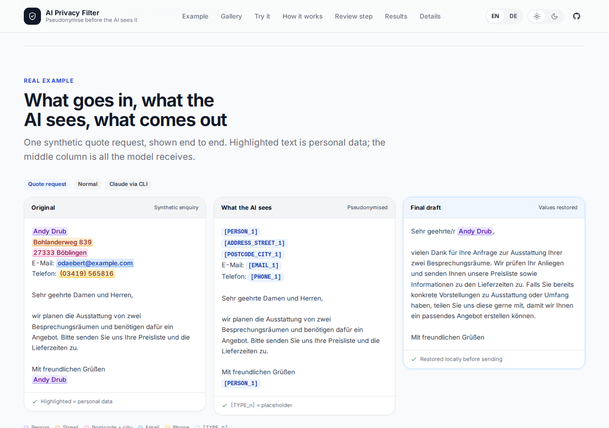

# AI Privacy Filter

**Use an AI model on customer email without sending it the customer's name,
address, phone number or bank details.**

The filter detects personal data in an enquiry, replaces each value with a typed
placeholder such as `[PERSON_1]` or `[IBAN_1]`, checks that none of the original
values survived, and only then asks a language model for a category, an urgency
and a draft reply. It pseudonymises the message, and the placeholders are put
back on your machine for a person to review.

This is **pseudonymisation**, not anonymisation: the values are replaced in the
text that leaves, and the mapping stays in memory. It is **not legal advice**.



## The problem

Customer enquiries contain exactly the data you do not want to paste into a
third-party AI service: names, e-mail addresses, phone numbers, IBANs, street
addresses and dates of birth. Blocking AI use entirely is one answer. Sending
the text as-is and hoping is another.

This project takes the middle path. The useful parts of the enquiry - what the
person wants, how urgent it is, what a good reply looks like - reach the model.
The personal details do not.

## What it does

1. **Detect** personal data locally with Microsoft Presidio, a German spaCy
   model and German pattern recognisers (phone, IBAN with checksum, postcode and
   city, street and house number, VAT ID, date of birth, names and
   organisations).
2. **Replace** every value with a placeholder, numbered per type in order of
   first appearance. The same value gets the same placeholder inside one
   message, including case and whitespace variants.
3. **Guard** the outbound text. If an original value is still present, the model
   is not called. Phone and IBAN values are also checked digit by digit.
4. **Ask the model** for `category`, `urgency` and `reply_draft` as JSON. It sees
   placeholders, never the original values.
5. **Restore** the placeholders in the draft, so a reviewer sees the real reply.
   The mapping is process memory only and is never logged or written to disk.

Steps 1, 2, 3 and 5 run in your process. The filtering step runs entirely on
your machine; `make test-local` runs that path with all sockets disabled as the
evidence. The one outbound network call is the model request, and it carries the
pseudonymised text.

## Headline results

The final run measured detection on the synthetic and GermEval test splits, then
triage on a fixed 40-enquiry subset. Every number below comes from the committed
result files linked beside it. Intervals are 95% Wilson intervals unless stated
otherwise.

- **[99.5%](results/SUMMARY.md)** of 1,074 synthetic gold spans were protected
  (95% CI 98.9-99.8) - also [`results/detection_synthetic.json`](results/detection_synthetic.json).
- **[1.9%](results/leak_rate.json)** of 160 synthetic test enquiries leaked at
  least one gold value (3 enquiries; 95% CI 0.6-5.4). The production guard
  blocked 0 of them because the detector had missed the value.
- **[0.0%](results/detection_synthetic.json)** over-masking: 0 of 19,824 replaced
  characters were outside a gold span (enquiry-level 95% CI 0.0-2.3).
- **[78.4%](results/detection_germeval.json)** recall for PERSON + ORG on 2,789
  GermEval 2014 test names (95% CI 76.8-79.9), against
  **[77.6%](results/detection_germeval.json)** for the Presidio-default baseline
  and **[0%](results/detection_germeval.json)** for the regex-only baseline.
- **[70.0%](results/runs/20261027T131500Z-triage-a1ad8ff/report.md)** joint
  category-and-urgency accuracy for the best backend on the fixed 40-enquiry
  triage subset (28/40; 95% CI 54.6-81.9), with
  **[0](results/runs/20261027T131500Z-triage-a1ad8ff/report.md)** leaked values
  in 160 calls across four backends and
  **[120/120](results/runs/20261027T131500Z-triage-a1ad8ff/report.md)** drafts
  restored exactly.

The numbers are descriptive. There are no pass thresholds, and no test number
was used to choose a configuration.

## Quick start

Requires Python 3.12 or newer and [uv](https://docs.astral.sh/uv/). The pinned
German spaCy model is installed by `make setup`.

```sh
make setup && make test
make reproduce
```

`make setup` installs the dependency groups and `de_core_news_lg` 3.8.0.
`make test` runs the unit, contract, service and evaluation tests without live
model calls. `make reproduce` rebuilds the detection results from the committed
corpus and the checksum-verified GermEval download with the network blocked
during scoring, then rebuilds the triage metrics and report from the stored
responses with no model call, and compares the files byte for byte.

Other useful targets:

```sh
make coverage     # tests plus the 85% branch-coverage floor on src/
make test-local   # the local filter path with sockets disabled
make lint         # ruff check, ruff format --check, mypy --strict on src/
make page-data    # export results/page/{examples,results}.json from the latest run
```

The GermEval download is optional for normal use and required for
`make reproduce`. Fetch it with `uv run python data/get_germeval.py`; it stays in
the git-ignored `data/external/` directory, is verified against pinned SHA-256
values, and is never committed or sent to a model.

## Backends

All four backends implement the same `LLMBackend` protocol. A backend returns a
validated `TriageResult` or a typed error; failures never raise out of the
pipeline. The exact argv, environment allowlist and error kinds are in
[`docs/backends.md`](docs/backends.md).

| Backend | What it uses | What leaves the machine | Honest notes |
|---|---|---|---|
| `claude-cli` | Your Claude subscription through the installed `claude` binary | The pseudonymised prompt on stdin, plus the JSON schema. The prompt is not in argv. | Runs in a fresh empty temporary directory with `--tools ""`, no session files and no user/project settings. The subscription login stays in place. Without an explicit model the CLI picks its own default. |
| `codex-cli` | Your ChatGPT subscription through `codex exec` | The pseudonymised prompt on stdin, plus the JSON schema. | Same isolation, with `--ephemeral`, `--ignore-user-config` and `--sandbox read-only`. **The sandbox blocks writes, not reads.** The prompt forbids tools and any tool event fails the call, but that is detection of what the CLI reports, not prevention. The scratch directory is empty, and the canary test proves a token one level above it does not reach the answer. |
| `byok` | Any OpenAI-compatible `chat/completions` endpoint with your own key | The pseudonymised prompt, your key and the endpoint you configure. The measured run used OpenCode Go. | Base URL, key and model come from `AIPF_BYOK_BASE_URL`, `AIPF_BYOK_API_KEY` and `AIPF_BYOK_MODEL`. Only `choices[0].message.content` is parsed; reasoning-token counts are recorded. This is the generic route for a provider you already pay for. |
| `ollama` (via `byok`) | A local model served by Ollama, reached through `BYOKBackend.for_ollama()` | The pseudonymised prompt to the Ollama endpoint. | Tested with `qwen2.5:1.5b` on own hardware via Ollama; no cloud AI was involved in that run. It is much weaker: 15/40 joint, 27/40 exact draft restores and 13 drafts with an invented placeholder. It is optional and never on the critical path. |

The `byok` route is also how a local Ollama endpoint is used: point the backend
at `http://127.0.0.1:11435/v1`, keep the 300-token ceiling and JSON-schema
response format, and no bearer key is sent. The T07 tunnel and its server lock
are documented in [`ops/ollama-remote/`](ops/ollama-remote/).

## Human review in n8n

`make e2e` starts a local compose stack: the gate built from this tree and a
pinned n8n image, both on a private network, with only n8n published on
`127.0.0.1:5678`. The exported workflow
[`workflows/enquiry-triage.json`](workflows/enquiry-triage.json) posts an
enquiry to `/redact`, then `/process`, branches on the guard verdict, shows a
review form with the pseudonymised text, category, urgency and restored draft,
and writes the approve/edit/reject result to `/data/out/<id>.json`.

The end-to-end check posts five synthetic dev-split enquiries, completes five
review forms in headless Chromium, covers approve, edit and reject, and asserts
that no gold value appears in the outbound text or the gate log. It passes from
a clean `.n8n-data/` directory. The workflow has no credentials; the gate URL
and backend name come from the container environment. See
[`docs/n8n.md`](docs/n8n.md) and the canvas screenshot at
[`results/page/n8n-workflow.png`](results/page/n8n-workflow.png).

This is a demonstration queue, not a production service: no webhook
authentication, no retry policy and one form per enquiry.

## Results

### Detection, synthetic test

160 synthetic German enquiries, 1,074 gold spans. B0 is the regex-only rule set
also used by the page's try-it box; B1 is Presidio's default registry with the
German spaCy model; B2 is the product detector with every German recogniser and
the frozen `strict` profile. Recall counts a gold span as protected only when
every character is inside a compatible prediction.

| system | protected | recall | leak rate (enquiries) | over-masking (characters) | GermEval PERSON+ORG recall |
|---|---:|---:|---:|---:|---:|
| B0 regex-only | 612 / 1,074 | 57.0% | 160/160 (100.0%) | 0.0% | 0.0% |
| B1 Presidio defaults | 575 / 1,074 | 53.5% | 145/160 (90.6%) | 6.2% | 77.6% |
| B2 full detector | **[1,069 / 1,074](results/detection_synthetic.json)** | **[99.5%](results/SUMMARY.md)** (95% CI 98.9-99.8) | **[3/160 (1.9%, 95% CI 0.6-5.4)](results/leak_rate.json)** | **[0.0%](results/detection_synthetic.json)** (95% CI 0.0-2.3) | **[78.4%](results/detection_germeval.json)** (95% CI 76.8-79.9) |

Sources: [`results/SUMMARY.md`](results/SUMMARY.md),
[`results/detection_synthetic.json`](results/detection_synthetic.json),
[`results/leak_rate.json`](results/leak_rate.json) and
[`results/detection_germeval.json`](results/detection_germeval.json). The
synthetic per-type Wilson intervals and the GermEval table are in the same two
JSON files and in `SUMMARY.md`.

The GermEval number is not an enquiry number. GermEval 2014 is German news and
Wikipedia text with PERSON and ORG labels; it has no e-mail, phone or IBAN
labels. B2's worst synthetic type is POSTCODE_CITY (134/137, 97.8%, 95% CI
93.8-99.3). B1 over-masks 817 of 13,203 replaced characters (6.2%) and leaks in
145 of 160 enquiries. B0 has no PERSON or ORG rule, so its 0% there is by
construction.

Restore round-trip on the same 160 enquiries:
**[160/160](results/restore.json)** byte-exact (95% CI 97.7-100.0). Missed
values stay in the text on both sides, so this measures
redaction/restoration fidelity, not recall.

### Triage, fixed 40-enquiry subset

Every available backend receives the same 40 attempts in the same order. An
error, guard block or leak counts as an incorrect answer. Latency uses successful
calls only. All figures are in
[`results/runs/20261027T131500Z-triage-a1ad8ff/report.md`](results/runs/20261027T131500Z-triage-a1ad8ff/report.md).

| backend | joint | category | urgency | median latency | restore-exact | leaked values |
|---|---:|---:|---:|---:|---:|---:|
| `claude-cli` | 28/40 (70.0%, 54.6-81.9) | 35/40 (87.5%) | 33/40 (82.5%) | 5,222 ms | 40/40 | 0 |
| `byok` (OpenCode Go) | 27/40 (67.5%, 52.0-79.9) | 32/40 (80.0%) | 35/40 (87.5%) | 4,786 ms | 40/40 | 0 |
| `codex-cli` | 25/40 (62.5%, 47.0-75.8) | 32/40 (80.0%) | 33/40 (82.5%) | 6,668 ms | 40/40 | 0 |
| `ollama` (`qwen2.5:1.5b`) | 15/40 (37.5%, 24.2-53.0) | 23/40 (57.5%) | 23/40 (57.5%) | 4,295 ms | 27/40 | 0 |

Honest findings, not tuned away:

- All 8 OTHER enquiries were read as SUPPORT by `byok` and `codex-cli`;
  `claude-cli` got 3 of 8 right. The OTHER templates look like support requests,
  so this is a label-boundary problem in the corpus as well as a model error.
- 5 (`byok`) and 7 (`claude-cli`, `codex-cli`) of the 24 NORMAL enquiries were
  labelled HIGH. Urgency is tied to category in this corpus, so urgency-only
  accuracy is not independent evidence.
- Every hosted draft restored exactly, but 7 (`byok`), 1 (`claude-cli`) and 11
  (`codex-cli`) drafts used no placeholder at all, which is reported separately
  because it is trivially exact.
- The 1.5B local model invented placeholders in 13 of 40 drafts; restore left
  them as written and the metric reports them.

## Limits

- The synthetic enquiries are template-generated German, not real customer mail.
  160 detection records and 40 triage records are small, and the intervals are
  correspondingly wide.
- GermEval is Wikipedia and news text, not enquiries, and has no e-mail, phone or
  IBAN labels. Its PERSON and ORG recall does not transfer directly to customer
  mail.
- Wilson intervals treat spans as independent trials and may be optimistic. The
  synthetic result files include an enquiry-cluster bootstrap as a sensitivity
  check.
- Urgency is confounded with category in this corpus. Category and urgency are
  also reported separately.
- One sample per backend per enquiry, and model output is not deterministic.
  Latency is one machine and one network path, not a benchmark.
- One reviewer scored the draft rubric. It is a small manual signal, not a
  production quality score.
- The Codex sandbox blocks writes, not reads. The isolation argument rests on an
  empty scratch directory, tools disabled at the CLI and a hard failure on any
  tool event - not on a read jail.
- The optional Ollama run is a small local model on one machine. It is not a
  recommendation for production quality.
- There are no pass thresholds. No test number was used to choose a
  configuration; the frozen profile was chosen on synthetic dev and GermEval
  train/dev only.

**This is pseudonymisation, not anonymisation. It does not make text anonymous,
it is not a compliance certification, and it is not legal advice.**

## Release gates

The final release check is recorded in
[`results/RELEASE_CHECK.md`](results/RELEASE_CHECK.md). It covers:

1. a fresh local clone running `make setup test reproduce` with no private
   environment and producing an identical `results/SHA256SUMS`;
2. gitleaks over both repositories' full history;
3. `scripts/scan_forbidden.py` over both repositories' full history;
4. no tracked GermEval file and no real-person example;
5. `make lint test` green with at least 85% branch coverage on `src/`;
6. complete `LICENSE`, `NOTICE` and `THIRD_PARTY.md`, with every third-party
   licence also named below.

## Credits

The project is Apache-2.0; see [`LICENSE`](LICENSE), [`NOTICE`](NOTICE) and
[`THIRD_PARTY.md`](THIRD_PARTY.md). Third-party components and their licences:

| Component | Licence | Use |
|---|---|---|
| Microsoft Presidio | MIT | detection and anonymisation primitives |
| spaCy and `de_core_news_lg` 3.8.0 | MIT | German NLP and NER |
| Faker | MIT | synthetic enquiries and the German first-name gazetteer |
| FastAPI | MIT | local HTTP service |
| Starlette | BSD-3-Clause | FastAPI's ASGI toolkit |
| uvicorn | BSD-3-Clause | ASGI server |
| pydantic | MIT | contracts and validation |
| httpx | BSD-3-Clause | OpenAI-compatible backend client |
| AnyIO | MIT | async compatibility layer used by Starlette |
| phonenumbers | Apache-2.0 | phone-number parsing inside Presidio |
| tldextract | BSD-3-Clause | URL/domain handling inside Presidio |
| requests | Apache-2.0 | HTTP client used by Presidio and tldextract |
| numpy | BSD-3-Clause (with 0BSD, MIT, Zlib and CC0-1.0 parts) | numeric dependency of spaCy/thinc |
| PyYAML | MIT | test and documentation configuration |
| pytest, pytest-cov, pytest-socket | MIT | tests |
| hypothesis | MPL-2.0 | property-based tests |
| ruff, mypy | MIT | lint, format and static typing |
| uv and uv_build | MIT OR Apache-2.0 | dependency resolution and build backend |
| gitleaks | MIT | secret scan on the developer machine |
| GermEval 2014 NER (Benikova, Biemann, Reznicek, LREC 2014) | CC BY 4.0 | held-out detection evaluation only; downloaded by script, not redistributed, no sentences shown |
| n8n (self-hosted) | Sustainable Use License | local workflow orchestration and human review |
| Ollama | MIT | optional local model runtime |
| Qwen2.5 1.5B Instruct | Apache-2.0 | optional local triage model; downloaded at run time, not redistributed |
| SaberOps worker adapters (portions) | Apache-2.0 | origin of the backend adapter pattern; attribution headers retained |

The page's own screenshot and illustrations are hand-drawn SVG or captured from
this project; the self-hosted Inter typeface is under the SIL Open Font License
1.1.

## Layout

```text
src/ai_privacy_filter/   service, CLI, detection, filter, guard, backends
src/ai_privacy_filter/recognizers/  German pattern and gazetteer recognisers
data/                    corpus generator and dataset loaders; data/external/ is git-ignored
docs/contracts.md        frozen contract reference
docs/backends.md         exact CLI argv, isolation, error kinds and Codex read limit
docs/n8n.md              local review stack and end-to-end check
METHOD.md                evaluation protocol, splits, baselines and rerun rules
results/                 measured results, page data and the release check
scripts/                 clean-clone, forbidden-string, reproduction and e2e helpers
tests/                   contract, service, CLI, evaluation and scan tests
compose.yaml             gate and n8n stack
workflows/               exported n8n workflow
```

No real customer data, real people's data or private infrastructure details are
part of this repository. The examples use synthetic text.
